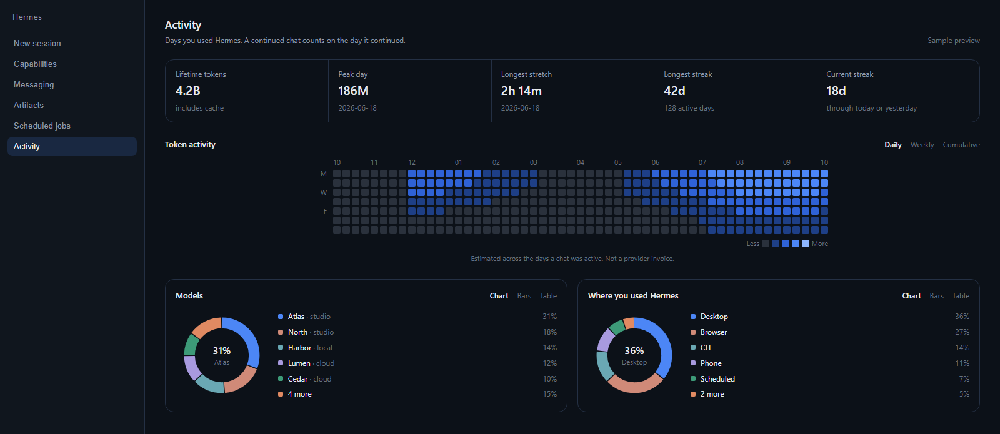

# Cadence

A local usage page for Hermes Desktop and Hermes Web. It shows a year heatmap, streaks, model mix, and where you used Hermes.



The picture uses sample numbers, not a real account.

## What it shows

- Current streak and longest streak, counted on days a chat was actually used
- A year heatmap with Monday, Wednesday, and Friday labels
- 30 day, 90 day, and all time ranges for tokens, peak day, models, and places
- This week against last week
- Busiest weekday and hour
- Chart, bars, or table for models and places
- Click a day to see the chats from that day

A continued chat counts on the day it continued. A model switch inside one chat is counted on each model. Cron and other automated sources do not keep a personal streak. Kanban and subagent sessions show in the heatmap and token totals, but a day with only those does not keep a streak either. Token totals are estimated across the days a chat was active. They are not a provider invoice.

## All profiles

By default Cadence reads the profile you are in. If you run several profiles, it can show them together instead:

```yaml
# config.yaml of the profile Desktop opens (usually default)
plugins:
  entries:
    cadence:
      settings:
        scope: all              # profile (default) or all
        exclude_profiles: []    # profiles to leave out of the all view
```

The page also has an All profiles and This profile switch. In the all view, each profile's `state.db` is opened read-only and copied into memory for that one report, and an Agents panel shows sessions and tokens by profile. The command takes `--scope all` or `--scope profile` too.

## Privacy

Cadence reads the selected profile's `state.db` in SQLite read-only mode, or every profile's when the scope is `all`. The desktop page asks Hermes to run `cadence summary` through the local `cli.exec` route. Nothing is uploaded. There are no network calls, no secrets, and no telemetry.

## Install

After the catalog listing is merged:

```sh
hermes plugins install cadence
hermes plugins enable cadence
```

Then turn on the Cadence desktop page in Settings, then Plugins. It appears in the sidebar and in the command palette as Open Cadence.

## Commands

```sh
hermes cadence summary --json
hermes cadence summary --scope all --json
hermes cadence day 2026-01-15 --json
```

`/cadence` in a Hermes session prints the current streak.

## Requirements

Hermes Agent `>=0.21.7`. Python comes with Hermes. No extra packages.

## License

MIT. See [LICENSE](LICENSE).
